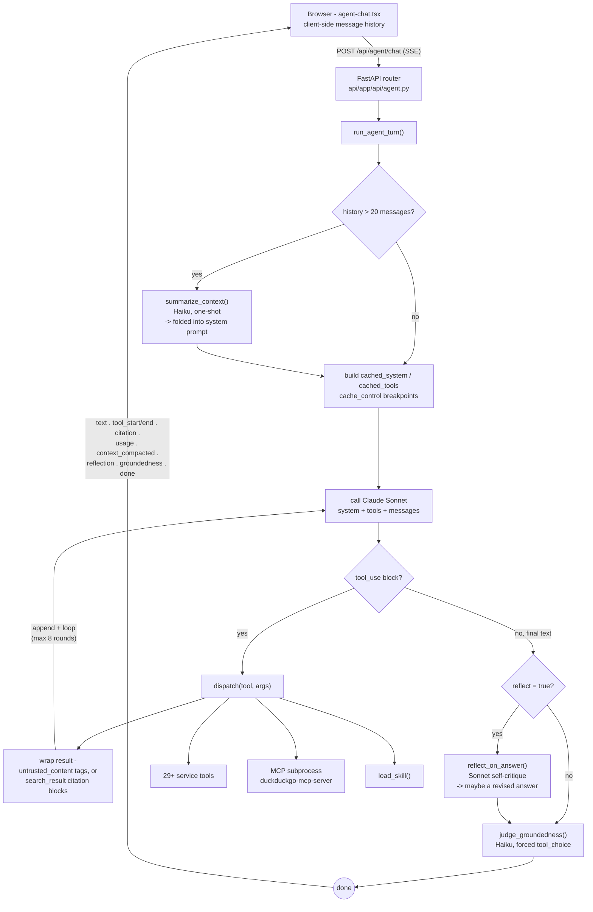

# The chat agent's harness

Context engineering decides what goes *into* a single model call. Harness engineering is the orchestration layer around it — the loop that calls the model, dispatches its tools, decides when to stop, and checks its own output before the user ever sees it. This is `run_agent_turn()` (`api/app/agent/loop.py`), the harness behind the chat widget.

## Core loop — one turn, start to finish

**Turn cap** — at most 8 tool-call rounds per turn (`MAX_TOOL_TURNS`). A harness decision: bound cost and latency rather than let the model loop indefinitely.

**Result wrapping** — every tool result is capped, and either tagged untrusted or converted to a real citation block before it re-enters the loop.

**Verification, not generation** — reflection and the groundedness judge run after the answer exists, to check or revise it, never to produce it from scratch.

**Fail-open** — compaction, reflection, and the judge each swallow their own errors and fall back to "as if this step didn't run." A harness failure never blocks the real answer.

## Sibling harnesses — same primitives, different shape

| | | |
|---|---|---|
| **`multi_agent.py`** Multi-agent research | Four personas run `run_agent_turn`-style tool loops concurrently in threads, each scoped to a filtered tool slice. A coordinator call synthesizes all four reports, then runs the same groundedness check. |
| **`injection_lab.py`** Injection lab | Splices an adversarial tool_result into a fresh conversation and runs the real model against it, undefended and defended, to test the harness's own trust boundary rather than demonstrate a feature. |
| **`evals/run_evals.py`** Agent evals | A harness *for* the harness: drives `run_agent_turn()` with a fixed question set and scores tool selection, forbidden phrasing, and groundedness - in-process or against a live deployment. |

## Where the line sits

Prompt caching and context compaction change what's *inside* a single call — that's context engineering. The turn loop, tool dispatch, the reflection pass, and the groundedness judge change *how many calls happen and what checks run between them* — that's the harness. The two layers compose: the harness decides when to call the summarizer or the judge; context engineering decides what each of those calls actually sees.

---
*Generated from `api/app/agent/loop.py`, `tools.py`, `multi_agent.py`, `injection_lab.py`, `evals/run_evals.py`. See also an interactive version of this diagram: https://claude.ai/artifact/B53UZWtSD463ZtHjhcxj5o*
